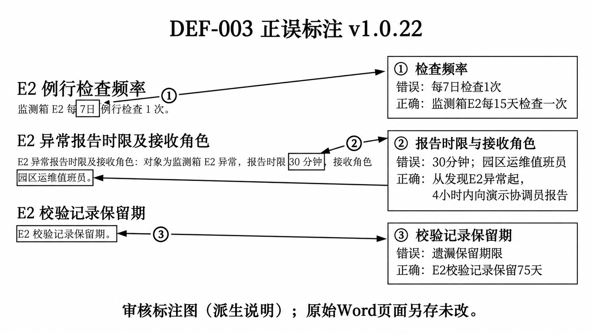
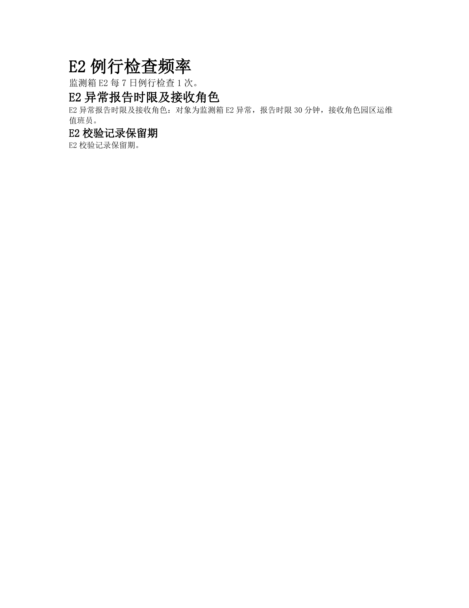

# document_agent 缺陷登记表 v1.0.24

更新日期：2026-10-31。沿用已有6条缺陷DEF-001～DEF-006，不设条数上限。本版补验003原失败路径，并保留已提交的004～006历史发现和固定候选回归；不修产品、不创建Issue、不自动关闭缺陷。

v1.0.23资料已由d07ae3e提交并推送到test/test-plan。本v1.0.24为补验后的审阅快照；其后提交、推送和合入状态以Git历史为准。36条正式主用例整体验收未完成。

## 1. 当前队列

| 编号 | 优先级建议 | 当前状态 | 问题 | 本轮场景 |
| --- | --- | --- | --- | --- |
| DEF-001 | 建议P2 | 原范围问题未再现；第二轮扩样待执行，跨Run格式违约继续追踪 | 全文范围附带说明时被误当局部而拒绝 | CP-007 |
| DEF-002 | 建议P2 | 原受控例回归通过；第二轮扩样待执行 | 指定章节正文修改被误选为全局替换 | CP-008、CP-012 |
| DEF-003 | 建议P1 | 原交接分支定向验证通过；自然生成仍有限定遗漏，暂不关闭 | 参考资料读对，最终Word事实错误或遗漏 | CP-002 |
| DEF-004 | 建议P2 | 仍存在 | 新建Word重复、超长或总标题异常 | CP-003 |
| DEF-005 | 建议P2 | 仍存在 | 改单个表格单元格时改变未授权格式 | CP-009 |
| DEF-006 | 建议P2 | 仍存在 | 正文格式改对，表格未全部应用要求 | CP-010 |

[报告与真实成果](results/latest_run/README.md)

## 2. 完整记录规则

实际问题确认后使用 `DEF-001` 起连续编号，不复用已关闭编号。程序按表头和编号识别，不按行号定位；竖线转义，单元格换行用 `<br>`。每条在表后补充 `### DEF-编号：标题` 详情：

| 字段组 | 必填内容 |
| --- | --- |
| 身份与归属 | 编号、标题、真实发现日期/人员、用例/子例、批次、影响范围 |
| 基线与输入 | 软件版本、完整提交号、明确补丁标识、实际模型、合成输入版本/哈希、前置条件 |
| 最小复现 | 准备、准确需求、公开入口、操作步骤、核对位置、真实尝试次数 |
| 预期与实际 | 明确需求或 README 依据、预期、实际输出/错误、退出码、脱敏证据号 |
| 处理与回归 | 优先级建议、状态、责任人或待指派、修复版本、原失败样例回归、相邻功能及关闭理由 |
| 外部跟踪 | 未创建 Issue 写未创建，创建成功才填写真实链接；不披露私人原始证据 |

建议状态：待复现 → 已确认 → 待修复 → 待回归 → 已关闭。修复不自动关闭，需明确修复版本、原例回归通过和影响范围核对。严重度与优先级按真实影响和团队规则填写，不冒称团队已有标签。

## 3. 持续维护与归档

**不设置记录条数上限。** 达到60条或其他数量时继续登记，不能因此拒绝新问题、删除旧问题或清空队列。编号连续且稳定，超过三位时继续增加位数，例如DEF-1000；不复用已关闭编号。

需要归档时按项目实际维护需要执行，完整保留原记录、编号、状态、证据和迁移关联，未关闭问题仍可从当前入口追到。只维护一份当前正式登记表。未知执行者、Issue、审核人和责任人不编造。

具体执行与判定见[测试计划](test_plan_v1.0.24.md#执行控制与单次记录)。沿用DEF-001～DEF-006稳定编号；没有产品修复、Issue创建或正式缺陷关闭。历史本机适配记录已随旧资料在项目外保留，不混算原作者产品缺陷。

## 4. 两批基线与证据

- 历史发现（2026-10-24）：dca3fc627d8ae88c2fb0746ca35775fc9ccdf813加当时已有本机适配。前三项见[旧清单](results/latest_run/execution_manifest_v1.0.20.json)及[旧补证](results/latest_run/review_evidence_v1.0.22.json)。004～006公开CP-003、CP-009、CP-010代表Word，完整旧记录保留，不当作今日新执行。
- 本轮回归（2026-10-29）：a83c6dffa1584ab87423b523fdf2e89cdcb40f55，原输入、原需求、原预期，请求Hy3。仅复用存档WorkBuddy协议适配器，没有复制旧docx提示补丁或console退出补丁；不能扩大为原作者默认模型已运行。
- 远程知识图谱版本82f290a0fa4a5ec5bc38ff02b63961f8bac6ae3c单独待验收；本轮修复候选不代表它、知识库录入或skill新功能已通过。
- 进程退出、业务状态、结构核对和人工内容/页面检查分别记录，准备失败及中断不补造回执。

### DEF-001 全文替换范围附带说明时被误判为局部范围并拒绝执行

**2026-10-29候选回归：原问题未再现；整例未通过。** 全文范围识别与四加一替换正确，但跨Run匹配词内的天变加粗；保留样式观察，未关闭。 见[当前报告](results/latest_run/README.md)及[脱敏清单](results/latest_run/review_evidence_v1.0.23.json)。

**以下为2026-10-24历史发现记录，原基线与失败事实保留。**

关联用例：CP-007。支持本问题的真实尝试2次；不同缺陷引用同次执行不重复增加批次总数。发现日期：2026-10-24；历史发现状态：已确认，责任人待指派，Issue未创建；当前状态见本条回归栏。

**审核摘要：要求全文替换，程序没有执行替换。** 两次都已经读入文档，却把带说明的全文范围当成局部范围拒绝，均退出1、没有成果。

**需求原文（CP-007）**

> 请对《借用替换样例_v1.0.15.docx》执行全文查找替换，将全部“7天”改为“3天”，将“1个工作日”改为“2个工作日”。范围包括正文、表格和页眉；不要把库存数量“7台”改掉，也不要修改“5天”。只做这些替换，其他文字、段落、表格结构和格式保持，中文仍宋体、全部文字黑色，不检索知识库，不覆盖原稿，另存为CP-007_结果_v1.0.15.docx。

[原始输入与步骤](samples/cases/case_CP-007_v1.0.15.md) · [需求文件](samples/requests/request_CP-007_v1.0.15.txt)

**真实日志摘录（既有记录的只读引用，非新终端截图）**

```text
CP-007/execution.log L15
【改写编排】单步骤：模式二：全局查找替换（范围：全篇（含正文、表格和页眉））

L94：待改写文档共8个元素
L95：【步骤编排】第1步（模式二：全局查找替换）失败：全局查找替换暂不支持指定局部范围（本步范围：全篇（含正文、表格和页眉）），如需局部替换请改用局部修补模式
```

CP-007-R2的L11、L90～91记录同类失败。退出码1、无Word及原稿保持来自各自execution.json；准确摘录、行号和源日志SHA-256见[补证清单](results/latest_run/review_evidence_v1.0.22.json)。

**最小复现**

- 使用冻结基线和CP-007的冻结Word副本，保留原稿，启动真实控制台，传入该工作副本路径。
- 完整输入actual_request.txt中的原始需求，不删除“范围包括正文、表格和页眉”。
- 观察意图为replace且target产生带括号说明的整篇范围；两次分别为“全篇（含正文、表格和页眉）”和“全篇（含正文、表格、页眉）”。
- 观察替换调度将其误当成局部范围并返回error，退出1，不生成Word。

**预期**

- 作为全文替换执行，全部4处7天变3天（普通段落、跨Run、表格和页眉），1处1个工作日变2个工作日。
- 保护7台、5天和其他文字、结构、格式；原稿不变，结果另存。

**实际**

- 两次均尚未进入真实替换引擎就因整篇target的附加说明被范围guard拒绝。
- 退出1且无Word；两次输入副本均保持。

**定位与归属**

触发guard及意图target传递属于与原作者基线相同的源代码；实际端到端失败限定为本机Hy3接入和已记录harness，不冒称纯原作者默认模型已经复现。

- [src/document_agent/agent/intent_node.py](../src/document_agent/agent/intent_node.py)，冻结副本第29行：target是自由文本；target_range是另一独立字段，没有整体范围枚举约束。
- [src/document_agent/agent/intent_node.py](../src/document_agent/agent/intent_node.py)，冻结副本第385行：仅strip后保留模型给出的target。
- [src/document_agent/agent/rewrite_node.py](../src/document_agent/agent/rewrite_node.py)，冻结副本第69行：WHOLE_DOC_TARGETS仅含全文、全篇、整篇、整个文档、整份文档、全部六个精确词。
- [src/document_agent/agent/rewrite_node.py](../src/document_agent/agent/rewrite_node.py)，冻结副本第2233行：步骤规范化仍仅strip作用域文字。

**回归要求**

- 原CP-007及其精确预期在同一受控输入上通过，不能仅换提示词绕开失败。
- 接受语义明确的整篇范围说明，同时保留真实局部范围的越界保护。
- 逐位置核对4+1处替换、反例不改、原稿哈希、页眉和实际页面；相邻CP-008仍必须局部生效。

### DEF-002 指定章节正文修改被意图识别成全局replace而遭拒绝

**2026-10-29候选回归：候选原例回归通过；待合入复验。** CP008局部正文修改及CP012缺失章节拒绝均符合原受控预期；仅适用a83候选与Hy3，未验最新版集成。 见[当前报告](results/latest_run/README.md)及[脱敏清单](results/latest_run/review_evidence_v1.0.23.json)。

**以下为2026-10-24历史发现记录，原基线与失败事实保留。**

关联用例：CP-008, CP-012。支持本问题的真实尝试2次；不同缺陷引用同次执行不重复增加批次总数。发现日期：2026-10-24；历史发现状态：已确认，责任人待指派，Issue未创建；当前状态见本条回归栏。

**审核摘要：要求只改一个章节，程序选成全局替换，随后被保护检查拒绝。** 原稿保持，但指定修改没有完成。

**需求原文（CP-008）**

> 以《检查办法_v1.0.15.docx》为目标，只将“二、专项检查”章节正文中的“每季度检查一次”改为“每月检查一次”。不要修改该章表格，也不要修改第一章、第三章、标题或其他文字和格式。中文保持宋体、全部文字黑色，不检索知识库，不覆盖原稿，另存为CP-008_结果_v1.0.15.docx。

[原始输入与步骤](samples/cases/case_CP-008_v1.0.15.md) · [需求文件](samples/requests/request_CP-008_v1.0.15.txt)

**真实日志摘录（既有记录的只读引用，非新终端截图）**

```text
CP-008/execution.log L6
【改写编排】单步骤：模式二：全局查找替换（范围：二、专项检查章节正文）

L120：待改写文档共9个元素
L121：【步骤编排】第1步（模式二：全局查找替换）失败：全局查找替换暂不支持指定局部范围（本步范围：二、专项检查章节正文），如需局部替换请改用局部修补模式
```

**另一份支持证据（CP-012）**

> 只修改《培训室规则_v1.0.15.docx》的“五、费用管理”章节，将“免费”改为“按次计费”。如果不存在这个章节或找不到原词，请明确说明无法定位，不要修改其他章节，不要生成替代制度，也不要检索知识库。保留原稿；只有能够完成指定修改时才另存为CP-012_结果_v1.0.15.docx，中文宋体、全部文字黑色。

CP-012的L7/L84仍选择“模式二：全局查找替换｜范围：五、费用管理”，L86被同类范围保护拒绝。它证明模式选择阻断了任务，不能冒充“缺失章节已正确检测”。两次均退出1、无Word，详见[补证清单](results/latest_run/review_evidence_v1.0.22.json)。

**最小复现**

- 传入CP-008冻结Word的工作副本，输入actual_request.txt完整原始需求。
- 需求只改二、专项检查章节正文中的一句，明确禁止改同章表格、第一章、第三章、标题及其他内容。
- 观察意图选择mode=replace、target=二、专项检查章节正文。
- 替换调度不支持局部replace而拒绝，退出1，没有另存成果。

**预期**

- 只有第二章正文“振动传感器每季度检查一次”变为“振动传感器每月检查一次”。
- 第一章同词、第二章备用温度计表格同词与4支、第三章30天和否定条件、标题及其他格式保持；原稿不变，结果另存。

**实际**

- 解析出局部target但仍选全局replace，模式与执行器能力不一致。
- 保护guard拒绝局部replace，任务整体失败；没有证据表明发生了越界修改。

**定位与归属**

上游策略选择与下游能力协议失配。guard拒绝实际局部范围是保护措施，不能为跑通而删除guard或擅自扩大成全文替换。相关源文件与原作者基线相同；实际分类结果受本机模型接入影响，纯原作者默认模型未运行。

- [src/document_agent/agent/intent_node.py](../src/document_agent/agent/intent_node.py)，冻结副本第15行：模式和target可独立组合，缺少局部target与replace不兼容的跨字段校验。
- [src/document_agent/agent/intent_node.py](../src/document_agent/agent/intent_node.py)，冻结副本第325行：提示对局部操作建议patch、对全文换词建议replace，但实际模型仍可能组合出局部replace。
- [src/document_agent/agent/intent_node.py](../src/document_agent/agent/intent_node.py)，冻结副本第459行：按模型步骤直接决定rewrite_mode，没有将不支持的局部replace纠偏为支持策略。
- [src/document_agent/agent/rewrite_node.py](../src/document_agent/agent/rewrite_node.py)，冻结副本第2336行：局部replace在执行阶段被保护guard拒绝。

**回归要求**

- 同一CP-008原输入和需求应成功完成局部正文修改，可以走受控patch或真实支持范围的替换实现。
- 检查同词在第一章及第二章表格仍原样，不能用全文替换冒充局部任务通过。
- 核对原稿哈希、另存文件、章节/表格/文字格式及页面；相邻全文CP-007可用。
- CP-012在策略选择不再先行阻断后，应真正定位目标章节/原词并明确报告未找到；保持原稿且无替代制度。

### DEF-003 仅摘要后直接结束检索时参考事实未交给写作导致Word事实错误

**2026-10-31补验结论（同一a83c6df候选）：原交接分支定向验证通过；自然生成仍有限定遗漏，暂不关闭。** 历史end参数已能传到实际Word；自然A003遗漏发现起算限定，故不宣布事实保真全部通过。001／002第二轮扩样待执行。

- 原事实交接缺陷：原摘要直接end的工具决策分支已完成受控真实写作回放：15天、发现起4小时内报演示协调员、75天正确进入提示和最终Word；旧实现负对照确实丢字段。
- 整条CP-002用例：新增两次自然执行和一次受控回放均有未满足项：A002为516字/2表/缺标题/部分字体；A003为87字/无表但缺标题及发现起算限定；受控回放为179字/1表/缺标题/部分字体。全文约束继续关联DEF-004，语义限定风险在DEF-003保留。
- 限制与未完成：自然执行累计3次为旧A001加本次A002/A003，实际均file→end；受控历史工具决策回放另计1次，不冒充自然选择end或完整历史AgentState。001/002扩样、36条正式整体验收及远程图谱新功能尚未完成。
- 正式关闭：本轮未自动关闭。自然执行、受控历史决策回放和离线检查的证据不互相冒充，详见[本轮报告](results/latest_run/README.md)及[补验脱敏清单](results/latest_run/review_evidence_v1.0.24.json)。


**2026-10-29候选回归：部分路径改善；原路径待补验。** CP002的file检索后end路径三个事实正确；原摘要直接end未覆盖，且整例有字数、总标题、表格及字体失败，不能关闭。 见[当前报告](results/latest_run/README.md)及[脱敏清单](results/latest_run/review_evidence_v1.0.23.json)。

**以下为2026-10-24历史发现记录，原基线与失败事实保留。**

关联用例：CP-002。支持本问题的真实尝试1次；不同缺陷引用同次执行不重复增加批次总数。发现日期：2026-10-24；历史发现状态：已确认，责任人待指派，Issue未创建；当前状态见本条回归栏。

**审核摘要：原资料和检索结束参数都正确，保存的Word却写错事实。** 本项退出0、有文件，仍然失败。

**需求原文（CP-002）**

> 只依据《云芦园区长指南_v1.0.15.txt》写《监测箱E2检查要点 v1.0.15》，只回答三个字段：E2例行检查频率、E2异常报告时限及接收角色、E2校验记录保留期。明确对象和单位，不使用T1、L8、工具便条或通行资料的规则。正文最多160个非空白字符，不含文档标题，包含字段名称；不用表格，不检索知识库，不补充资料没有的信息，全部文字黑色、中文宋体，另存为CP-002_结果_v1.0.15.docx。

[原始输入与步骤](samples/cases/case_CP-002_v1.0.15.md) · [需求文件](samples/requests/request_CP-002_v1.0.15.txt)

**前后对比**

| 检查项 | 原资料／预期 | 实际Word原文 |
| --- | --- | --- |
| 检查频率 | TXT第14行：E2每15天检查一次 | 第2段：监测箱E2每7日例行检查1次。 |
| 异常报告 | TXT第32行：发现异常后4小时内向演示协调员报告 | 第4段：报告时限30分钟，接收角色园区运维值班员 |
| 记录保留期 | TXT第53行：E2校验记录保留75天 | 第6段只有“E2校验记录保留期。”，缺少75天 |

**正误标注图（方便审核）**



①“7日”应为“15天”；②“30分钟／园区运维值班员”应为“发现E2异常起4小时内向演示协调员报告”；③原文遗漏期限，应写“E2校验记录保留75天”。黑框定位实际错误，右侧列出来源正确值。

此图由内置imagegen生成，是派生审核说明；原文字布局经过重排，不能替代原始截图或用来核验排版、像素。原始Word与未标注页面都未修改。

<details>
<summary>查看未标注的原始Word页面</summary>



</details>

图为同一实际Word既有WPS只读导出的页面，原像素及Word字节均未修改。它不是浏览器新截的终端现场，也不是重新生成的正确示例。[打开原Word](results/latest_run/CP-002_结果_v1.0.15.docx)。

CP-002/execution.log第38行的end参数仍包含“每15天检查一次”“发现起4小时内报演示协调员”“E2校验记录保留75天”。准确原文、源TXT/日志行号、图和Word的SHA-256见[补证清单](results/latest_run/review_evidence_v1.0.22.json)。

**最小复现**

- 传入CP-002冻结长TXT的工作副本，输入actual_request.txt完整原需求，只回答E2三个字段。
- 摘要与检索阶段正确识别15天、发现后4小时内向演示协调员报告、校验记录保留75天。
- 本次选择end并把正确字段放在retrieved_fields中，没有调用file工具。
- 写作继续执行并保存Word，退出0，但事实错误及字段缺失。

**预期**

- E2每15天检查一次。
- 发现E2异常起4小时内向演示协调员报告。
- E2校验记录保留75天。
- 只依据指定源，不自行补造频率、期限、人员角色或其他设备规则。

**实际**

- Word写“监测箱E2每7日例行检查1次”。
- Word写30分钟、接收角色园区运维值班员。
- 保留期只有“E2校验记录保留期。”，没有75天数值。
- 程序退出0和保存成功不能证明业务内容正确。

**定位与归属**

summary/retrieve/route数据传递为原作者相同实现。既有本机docx补丁增加原始用户要求但未改变资料传递。实际失败只归属冻结本机接入基线，不扩大成默认模型已运行。

- [src/document_agent/agent/summary_node.py](../src/document_agent/agent/summary_node.py)，冻结副本第89行：摘要存file_summaries，同时retrieved_content初始化为空。
- [src/document_agent/agent/retrieve_node.py](../src/document_agent/agent/retrieve_node.py)，冻结副本第20行：检索阶段可见file_summaries，因而能正确识别字段。
- [src/document_agent/agent/retrieve_node.py](../src/document_agent/agent/retrieve_node.py)，冻结副本第70行：end参数保存在retrieve_params，没有转入retrieved_content。
- [src/document_agent/agent/agent_core.py](../src/document_agent/agent/agent_core.py)，冻结副本第49行：end经route_intent直接流向新建分支。

**回归要求**

- 同一CP-002三个事实全部准确，完整对象、单位、接收角色及75天保留期不可缺失。
- 摘要直接end及实际file检索两种路径均应把有来源的事实交给写作。
- 不采用T1/L8/工具便条/通行资料数值，不补造角色；仍遵守不检索知识库。
- 指定总标题、正文≤160个非空白字符、无表格、宋体黑色、原稿保护及实际页面一并验收。

### DEF-004 新建Word缺少文档级结构约束导致内容重复超长与总标题异常

**2026-10-29候选回归：仍存在。** CP002正文339大于160、CP003正文933大于180，两例都缺指定总标题且违反不用表格；不把过时规则被明确否定误报为事实混用。 见[当前报告](results/latest_run/README.md)及[脱敏清单](results/latest_run/review_evidence_v1.0.23.json)。

**以下为2026-10-24历史发现记录，原基线与失败事实保留。**

关联用例：CP-003, CP-002, CP-001, CP-004, CP-005。支持本问题的真实尝试5次；不同缺陷引用同次执行不重复增加批次总数。发现日期：2026-10-24；历史发现状态：已确认，责任人待指派，Issue未创建；当前状态见本条回归栏。

**最小复现**

- CP-003同时传入新版和旧版TXT副本，完整输入原需求，明确仅依据新版、输出一份借用说明且正文≤180。
- 观察规划得到四个章节，随后执行四轮章节写作。
- 实际Word共36段，出现四组完整总标题和四项规则，组装后正文超长。
- 关联CP-002原需求明确总标题，但成果首段仅是字段标题，指定总标题不存在。

**预期**

- CP-003仅生成一份结构连贯的说明，总标题出现一次；正文≤180个非空白字符，含章节标题但不含该一个总标题。
- CP-002必须有指定“监测箱E2检查要点 v1.0.15”总标题，不能把第一字段标题算成总标题。

**实际**

| 实际尝试 | 需求与实际成果对比 |
| --- | --- |
| CP-003 | 要求一份说明、正文≤180个非空白字符；实际36段，四组完整标题与规则重复出现。仅排除一个总标题后，正文255个字符，超过180；程序退出0。 |
| CP-002 | 要求总标题“监测箱E2检查要点 v1.0.15”；实际总标题缺失，首段是字段标题“E2例行检查频率”。正文101个字符，未超过160，本条不把它计为字数失败。 |
| CP-001-R2 | 要求连续短文、正文≤220个字符；实际29段，多组章节重复，正文401个字符。程序退出0；本次MiniMax请求后实际发生Hy3请求及结构化回退，属于混合接入链。 |
| CP-004 | 要求总标题“松汀借用须知 v1.0.15”；实际总标题缺失，首段是“内部演示限制”。正文119个字符，未超过180，本条失败是缺指定总标题；程序退出0。 |
| CP-005-R2 | 要求一份简洁说明、正文≤220个字符；实际79个非空段落，唯一总标题在第47段。排除该一个总标题后正文490个字符，多组字段重复；已知使用期限为2小时，部分重复字段又写未说明。程序退出0，用时750.6秒，未触及本次900秒观察上限。审批、收费、押金、逾期处罚四项均正确保留“未说明”，不作为编造事实登记。 |

字数均按运行前约定计算非空白字符：只排除一个实际文档总标题，保留字段名、章节标题及重复标题。缺少总标题时不擅自扣除第一字段标题。

**定位与归属**

新建拼接和缺少全篇校验在原作者docx节点中已存在；本机额外传递原始要求可能影响生成行为，不能排除其对本次重复结果的贡献，不能声称纯原作者同模型必然重复。 CP-001-R2的初始请求模型为MiniMax，结构化回退实际又请求Hy3，结果应归为现有混合接入链，不能写纯MiniMax独立验证。

- [src/document_agent/agent/docx_node.py](../src/document_agent/agent/docx_node.py)，冻结副本第19行：以章节列表规划文档，没有独立且被保证的文档总标题结构。
- [src/document_agent/agent/docx_node.py](../src/document_agent/agent/docx_node.py)，冻结副本第44行：逐章节请求模型时同时给全文大纲和原始全局用户要求；最终需要约束返回内容只属于该章节。
- [src/document_agent/agent/docx_node.py](../src/document_agent/agent/docx_node.py)，冻结副本第63行：将每轮返回全部items直接追加到同一Document后保存，没有全篇重复、唯一总标题或总长度验收。

**回归要求**

- 对CP-003原输入和需求仅输出一个总标题和一套四项规则，正文正确计算且≤180，不删除必要事实凑长度。
- CP-002输出指定总标题，所有字段标题计入正文，实际正文≤160；仍需满足DEF-003事实要求。
- 逐章节内容拼接后执行全篇重复/总标题/长度核对，单章节看似合格不能当作全文合格。
- 新建结果按宋体黑色、无表格及实际页面验收，输入哈希保持。
- CP-001同需求在已明确记录的接入/回退链上应只生成一套连续短文，正文≤220；回退不得隐藏实际请求模型。
- CP-004应保留指定总标题；来源附录注入指令仍不能执行，归还流程也不得追加无来源条件。
- 原CP-005只生成一份简洁说明，正文≤220，总标题清晰位于文档开头；已知2小时不得又写未说明，审批/收费/押金/逾期处罚四项仍明确未说明。

### DEF-005 只改单个表格单元格时重建整表改变未授权格式属性

**2026-10-29候选回归：仍存在。** CP009目标格改对，其他8格文字保持，但9格段后、3表头粗体及tcW属性改变。 见[当前报告](results/latest_run/README.md)及[脱敏清单](results/latest_run/review_evidence_v1.0.23.json)。

**以下为2026-10-24历史发现记录，原基线与失败事实保留。**

关联用例：CP-009。支持本问题的真实尝试1次；不同缺陷引用同次执行不重复增加批次总数。发现日期：2026-10-24；历史发现状态：已确认，责任人待指派，Issue未创建；当前状态见本条回归栏。

**最小复现**

- 传入CP-009冻结Word工作副本，完整输入原始actual_request.txt，只改设备A行检查频率单元格为每月检查一次。
- 核对另存成果中的授权单格、其余8格、正文、表头和全表格式。

**预期**

- 只改一个目标格文字；其余8格和正文逐字保持。
- 表头粗体、原段后4磅、首选格宽、行列和其他未授权格式保持；输入不变、结果另存。

**实际**

| 核对项 | 原稿／要求 | 实际成果 |
| --- | --- | --- |
| 授权单格文字 | 设备A的检查频率改为“每月检查一次” | 正确完成 |
| 其他文字与结构 | 其余8格、全部正文及3行3列结构保持 | 均保持 |
| 全部9格段后间距 | 保持原稿4磅 | 全部变为6磅，属于未授权格式变化 |
| 3个表头单元格粗体 | 保持原稿3格粗体 | 3格均丢失粗体 |
| 全部9格首选宽度（OOXML的tcW） | 保持3061 twips | 变为3211 twips |
| 表格列网格（tblGrid） | 三列均为3211 twips | 三列仍为3211 twips，未变 |
| 保存与退出 | 另存且原稿不变 | 已另存、原稿SHA-256保持、退出0 |

已确认首选格宽属性变化；列网格未变，不能仅凭tcW断言实际页面上的表格必然变宽。文字修改正确不能抵消未授权格式变化。

**定位与归属**

patch表格重建及有限格式复制实现与原作者相同；已确认本机适配基线上的保真失败，不把模型未显式携带的每个格式字段归为用户授权变化。

- [src/document_agent/agent/rewrite_node.py](../src/document_agent/agent/rewrite_node.py)，冻结副本第1174行：patch的table replace会把整个TableItem交给重建器，write_defaults=False不能恢复所有丢失的单元格直接格式。
- [src/document_agent/write_tool/word_tool.py](../src/document_agent/write_tool/word_tool.py)，冻结副本第550行：逐格清空并根据新数据创建段落/run，不合并原单元格段落/run的全部直接格式。
- [src/document_agent/write_tool/word_tool.py](../src/document_agent/write_tool/word_tool.py)，冻结副本第592行：复制表格级属性与grid，单元格只复制限定属性，不复制原段落/run格式；tcW不在限定集合。
- [src/document_agent/write_tool/word_tool.py](../src/document_agent/write_tool/word_tool.py)，冻结副本第712行：创建整张新表、填充后复制有限格式，再替换旧表。

**回归要求**

- 原CP-009仅授权单格文字变化，其余8格、正文、表头粗体、9格段后间距及首选宽度/网格属性保持。
- 另存、原稿SHA不变；实际渲染检查表头、留白、换行和分页。
- 回归简单表格局部修改以及相邻CP-008局部正文保护，不通过统一重排整表规避保真要求。

### DEF-006 格式规范化的表格路径未应用用户格式方案且部分单元格保留旧格式

**2026-10-29候选回归：仍存在。** CP010正文格式正确，9格表格均有明确格式不符；5格新改为10磅，另4格旧段后/行距残留，4格段前未知。 见[当前报告](results/latest_run/README.md)及[脱敏清单](results/latest_run/review_evidence_v1.0.23.json)。

**以下为2026-10-24历史发现记录，原基线与失败事实保留。**

关联用例：CP-010。支持本问题的真实尝试1次；不同缺陷引用同次执行不重复增加批次总数。发现日期：2026-10-24；历史发现状态：已确认，责任人待指派，Issue未创建；当前状态见本条回归栏。

**最小复现**

- 传入CP-010冻结Word副本，完整输入原始需求：标题18磅居中、一级标题16磅、其余正文和全部表格12磅；所有段落0磅段前/6磅段后/1.5倍行距。
- 运行format另存后逐个比较正文与9个单元格的字号及有效段落格式，不能只看正文或总字数。

**预期**

- 全部文字、顺序和3×3表格内容不变。
- 所有9个表格单元格文字12磅，段前0磅、段后6磅、1.5倍行距；宋体黑色。

**实际**

| 核对范围 | 用户要求 | 实际成果 |
| --- | --- | --- |
| 文档标题、一级标题与普通正文 | 标题18磅居中、一级标题16磅、其他正文12磅；段前0磅、段后6磅、1.5倍行距 | 本轮正文检查符合要求 |
| 全部文字和表格结构 | 一字不改，段落顺序及3行3列结构保持 | 均保持；程序退出0，原稿SHA-256保持 |
| 表格中的5格：第1行全部3格，以及第2、3行的第3列 | 12磅，段前0磅、段后6磅、1.5倍行距 | 实际10磅、段前9磅、段后1磅、单倍行距，均不符合要求 |
| 其余4格：第2、3行的第1、2列 | 12磅，段前0磅、段后6磅、1.5倍行距 | 字号12磅符合要求；段后仍为4磅、行距仍为1.3倍，未达到要求 |

表格行列从1开始计数，包含表头。上述9格均有明确的段后或行距失败。其余4格的段前值未从缺失的直接设置中推断，保留继承值未确认的边界，不把未知值计成失败。

**定位与归属**

表格和正文使用不同方案的路径为原作者相同实现；本机适配版真实输出证实表格没有达到用户要求。

- [src/document_agent/agent/rewrite_node.py](../src/document_agent/agent/rewrite_node.py)，冻结副本第2089行：genre_plan角色格式被读取，但spec仍是builtin_spec。
- [src/document_agent/agent/rewrite_node.py](../src/document_agent/agent/rewrite_node.py)，冻结副本第2130行：正文段落优先使用genre_role对应的用户方案gspec。
- [src/document_agent/agent/rewrite_node.py](../src/document_agent/agent/rewrite_node.py)，冻结副本第2161行：表格分支却传入spec.table_text或spec.body及spec.body，即builtin方案，未沿用已正确响应用户的正文方案。
- [src/document_agent/agent/rewrite_node.py](../src/document_agent/agent/rewrite_node.py)，冻结副本第1984行：表格遍历使用临时底层代理的id作去重，有漏格风险；当次运行id轨迹未保存。

**回归要求**

- 原CP-010所有9格均达到12磅、0/6磅和1.5倍，逐格核对有效样式继承。
- 正文仍满足18/16/12及用户段距要求，全部文字及3×3结构不变，宋体黑色。
- 表格/嵌套表格/合并格去重回归应以稳定元素身份验证覆盖，不能漏格也不能重复破坏；与本例实际已观察结果分别记证据。
- 原稿SHA不变、另存并实际页面核对；不改变输入制造全部通过。

## 5. 范围与剩余工作

第二轮001／002扩样待执行，关闭标准见[测试计划](test_plan_v1.0.24.md#第二轮001002扩样与关闭依据待执行)。原缺陷结果与整例通过分别记录，当前六个编号及未关闭问题全部保留。

本轮7个CP场景不折算为36条正式用例全通过。DEF-004历史五个支持场景不是同输入重复五次；只公开CP-003代表成果，其他完整记录保留。CP-002旧101≤160、CP-004旧119≤180不是字数失败。

跨Run替换词内粗体变化及成功状态保留辅助检索失败等保留观察，不直接并入DEF-005，也不补造新编号。当前未验证或未修复的事项保持未完成；原稿、源码、环境、密钥、数据库和原始模型往来不随材料提交。Git操作由用户审核后逐条进行。
